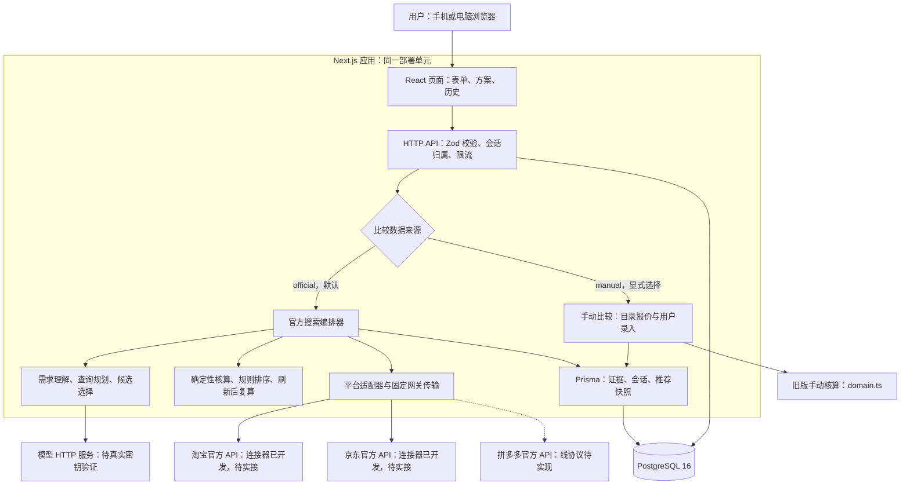
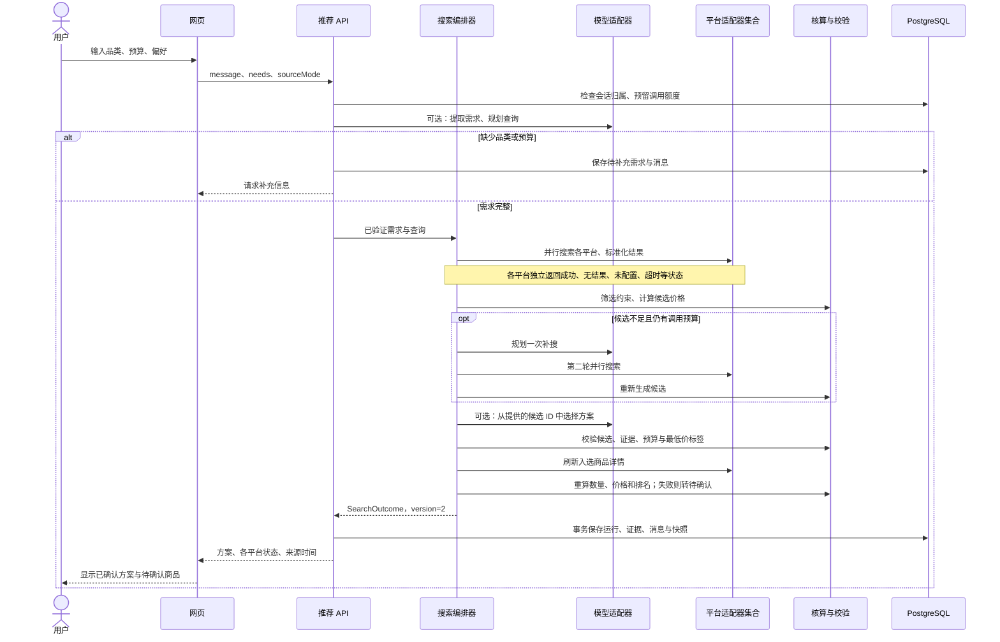
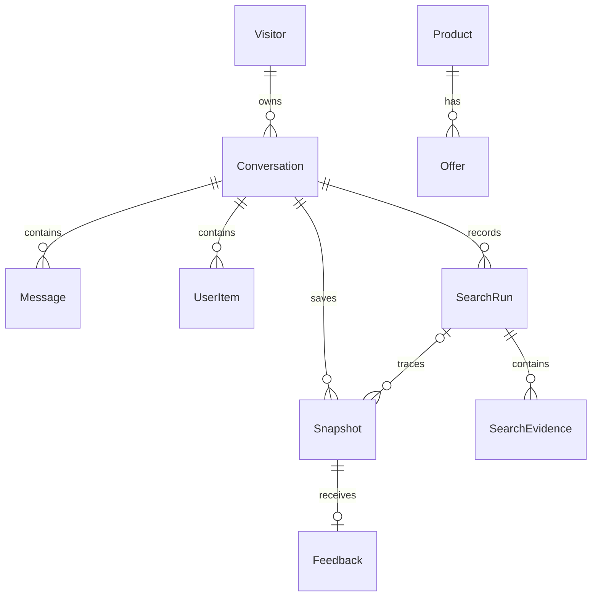
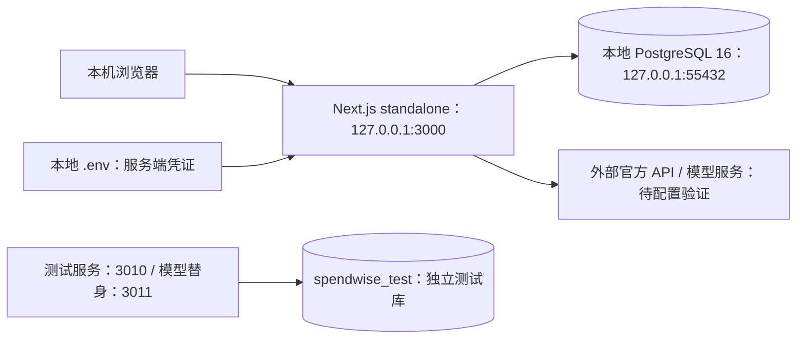
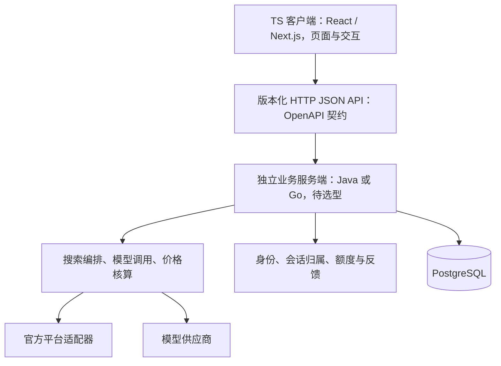

# 帮你省：技术架构与设计图

核对日期：2026-10-22。本文描述现有代码；后续演进单独标注。设计基线为提交 `35164ab`。用户已确定后续采用 TS 客户端与 Java 或 Go 独立服务端，见第 8 节。

## 1. 项目形态与选型

面向消费者的 AI 日用品选购助手，目前覆盖抽纸、卷纸和洗衣液。交付形态是适配手机的 Web 应用。

采用 **TypeScript 模块化单体**：React 页面与 Next.js Route Handlers 由同一套应用部署，服务端内部按职责划分模块；PostgreSQL 独立运行。浏览器通过 HTTP JSON API 访问服务端，不能直接调用带密钥的平台接口或连接数据库。

| 层次 | 当前技术 | 责任与依据 |
| --- | --- | --- |
| 用户界面 | React 19、Next.js App Router、CSS/Tailwind CSS 4 | 需求表单、平台状态、方案、历史和反馈；`src/components/` |
| HTTP API | Next.js 16 Route Handlers、Node.js 24 | 输入校验、身份与归属检查、路由分发；`src/app/api/` |
| 业务逻辑 | TypeScript、Zod 4 | 搜索编排、报价标准化、核算、模型输出校验；`src/lib/shopping/` |
| 模型连接 | 服务端 HTTP，兼容 Chat Completions JSON 接口 | 默认配置 DeepSeek；以环境变量切换兼容供应商；未配置真实密钥 |
| 数据访问 | Prisma 7、PostgreSQL 驱动适配器 | 类型化查询、事务、schema 和迁移；`src/lib/db.ts`、`prisma/` |
| 存储 | PostgreSQL 16 | 会话、证据、快照、反馈、限流计数 |
| 验证 | Vitest、Playwright、TypeScript、ESLint | 核算/契约测试、API 与桌面/手机模拟测试 |
| 交付 | Next.js standalone、Dockerfile、Compose | 本地 standalone 已验证；容器交付定义存在，整套容器运行尚未验收 |

当前不需要微服务、消息队列或向量数据库：核心工作是有截止时间的接口查询和结构化金额比较，同一进程便于控制事务和调用预算。代价是各模块共享应用的发布周期与进程资源。

## 2. 图一：系统总览

实线表示当前代码中的路径；虚线表示仍待实现的拼多多线协议。

模型、平台和数据库访问发生在服务端。密钥只从服务端环境变量读取。手动模式的演示目录与官方搜索分开；官方查询失败时返回实际失败状态。

## 3. 为什么使用 TypeScript

最直接的收益是：前端、API 和业务模块可以共用数据契约，三平台不同的响应先转换成统一结构，再交给模型与核算模块。

| 项目中的实际问题 | TS 带来的收益 | 仍需配合的机制 |
| --- | --- | --- |
| 平台字段与状态容易写错 | `PlatformProvider` 约束适配器接口，平台/状态联合类型可在编译时检查拼写 | 官方协议夹具和真实联调 |
| 起售价、未知运费容易被误当成确定价格 | `priceKind`、`shippingFen: number \| null`、`totalFen: number \| null` 明确表达未知 | `strict` 类型检查、Zod 和 `pricing.ts` 规则 |
| UI 与服务端修改不同步 | React 可引用 `ShoppingNeeds`、`SearchOutcome`，重命名和接口变更更易发现影响 | HTTP 接口仍是 JSON；来自网络的数据需要运行时校验 |
| 数据库查询与结构调整容易出错 | Prisma 生成查询类型，schema 变更后可发现部分调用不匹配 | 数据库迁移、约束、事务和回归测试 |
| 模型返回不可靠的 JSON | schema 推导的类型让验证后的对象可在模块间传递 | 外部输出先作为未知数据，再 `safeParse` 和业务校验 |

例如统一报价对象允许 `shippingFen=null`。这表示运费未知；核算函数会把该方案放入“待确认”，而不是把运费当成 0。TypeScript 帮助调用方处理这个分支，最终规则仍由程序实现。

边界也很明确：TS 类型在运行时不会自动校验 JSON，不能证明商品价格真实，也不能自动保证金额单位。当前 `budgetFen` 等字段依靠命名、整数分计算和测试约定单位，没有使用专门的金额品牌类型。Prisma 的 JSON 列也需要额外的业务结构校验。

这个应用以 HTTP、数据库等 I/O 工作为主，TS 方便复用 Web 技术与维护一套代码。它并不意味着价格算法更准确或计算性能更高。以后若有复杂离线优化、模型训练任务，可以增加独立计算服务，现阶段没有这类实现。

## 4. 图二：一次官方推荐的时序

入口：`POST /api/conversations/:id/recommend`。`sourceMode` 默认 `official`。

这是一个由服务端控制步骤和工具的有限流程 Agent。模型负责理解需求、规划查询和选择候选；程序负责请求地址、调用次数、金额、硬约束、最终校验及展示说明。当前直接使用 HTTP 模型适配器，没有引入 LangChain、LangGraph 或通用自主工具循环。

模型不能凭空生成商品、价格和购买链接；展示说明使用服务器校验过的模板。无模型密钥或输出无效时采用规则流程。规则比较需要用户表单或历史记录提供足够需求，不具备无模型时理解任意自然语言的能力。

### 业务模块与代码位置

| 模块 | 文件 | 输入 → 输出 |
| --- | --- | --- |
| 契约与需求合并 | `contracts.ts`、`needs.ts` | 外部 JSON、稀疏偏好更新 → 校验后的需求/报价/证据 |
| 查询规划 | `planner.ts` | 用户需求 → 最多两个查询；可选一次补搜规划 |
| 编排 | `orchestrator.ts` | 需求、平台集合、上下文 → 版本化推荐结果 |
| 并行查询 | `search.ts` | 查询集合 → 各平台独立状态与去重报价 |
| 官方协议 | `providers/taobao.ts`、`providers/jd.ts`、`transport.ts` | 签名请求 → 标准化报价；固定官方网关 |
| 报价核算 | `pricing.ts` | 报价、数量、预算、资格 → 候选与规则排名 |
| 模型选择 | `decision.ts`、`model-client.ts` | 有限候选 → 经校验的选择，或规则回退 |
| 额度与时限 | `budget.ts`、`runtime.ts`、`../security.ts` | 请求上下文 → 本次计数与数据库日配额 |
| 持久化 | `repository.ts` | 推荐结果 → 运行记录、证据和快照事务 |

以上相对路径以 `src/lib/shopping/` 为基准。旧手动流程使用 `src/lib/domain.ts`、`catalog.ts` 和 `model.ts`，与官方搜索共用会话入口。

### 核算和失败规则

- 总支出以整数“分”计算；单位成本排序比较未取整的比例，展示时再取整。
- 必需数量、总用量和 `maxPacks` 都要满足；包装量刷新后重新核算。
- 运费、具体 SKU、库存或优惠资格未知时，取消确定到手价；超预算或违反已知规格的候选剔除。
- 只比较同计量口径的单位成本，不自动换算质量与体积，不从标题推断可靠规格或优惠。
- 每次最多两轮搜索、12 次搜索尝试、6 次详情/链接尝试、3 次模型调用；重试计数。接口能力中预留转链，当前没有单独的转链调用实现。
- 平台单次请求上限 8 秒；一次网络/HTTP 5xx 重试；429 和权限错误直接返回。模型单次上限 12 秒。
- 搜索上下文目标截止时间 45 秒；编排阶段的补搜/决策模型提前 10 秒截止，给详情刷新留时间。数据库预留、保存和网络传输不构成严格的 HTTP 全链路 45 秒 SLA。
- 共享缓存默认停用；`cache.ts` 只是已有并经过测试的辅助实现，尚未接入生产查询流程。

## 5. 图三：数据库关系

以下关系对应 `prisma/schema.prisma`。`Invite` 负责准入，`RateBucket` 独立记录额度，不与业务实体建立外键关系。

| 数据 | 用途与生命周期 |
| --- | --- |
| `Invite`、`Visitor` | 邀请码 hash、使用次数、匿名身份 token hash 与到期时间 |
| `Conversation`、`Message` | 需求上下文与消息；按匿名身份隔离，过期后禁止读取 |
| `SearchRun`、`SearchEvidence` | 每次平台状态、起止时间与必要字段证据 |
| `Snapshot`、`Feedback` | 当时推荐结果、条件与反馈；官方快照 `version=2`，保留旧手动快照兼容 |
| `Product`、`Offer` | 手动比较使用的目录数据，支持 CSV 导入和显式演示数据 |
| `UserItem` | 用户在当前会话补充的商品与所见报价，不自动抓取链接 |
| `RateBucket` | 按窗口记录 API、平台、模型调用计数；数据库原子更新 |

需求、报价和快照等可变结构采用 Prisma `Json` 列；身份和归属关系采用外键。这样能较快演进平台字段，但 JSON 内部结构主要由应用校验，不能依赖数据库自动保证其业务正确性。

会话默认保留 30 天。删除会话会级联删除消息、用户商品、运行记录、证据、快照和反馈；过期物理清理由 `scripts/cleanup.ts` 执行。历史快照展示当时价格，重新查询生成新快照。关联运行单独删除时，快照的 `searchRunId` 置空。

## 6. 图四：部署拓扑与信任边界

### 当前本机已运行方式

本机开发库为 `spendwise`；测试使用 `spendwise_test`，平台协议测试注入模拟响应。GitHub 保存源代码、迁移和文档；它不是当前应用服务器或数据库托管环境。

### 已有容器定义，尚待整体验收

`compose.yaml` 定义 `db → migrate → app` 启动顺序，以及定时执行清理脚本的 `cleanup` 容器。数据库使用持久卷，应用和数据库端口绑定宿主机回环地址。该定义没有公网 HTTPS 入口。

后续公网部署需增加受控的 HTTPS 入口和实际托管环境，并验证迁移、备份恢复、重启、连接数及外部 API 网络可达性；当前未部署这些组件。暂不把 Redis、队列、负载均衡和自动扩缩容画成已存在的设施。

### 已实现的访问边界

- 浏览器使用 HttpOnly 会话 cookie；服务端检查会话有效期、会话归属与修改请求 Origin。
- 输入使用 Zod 校验；API 请求体大小上限 32 KiB；未知服务器错误返回统一错误，避免输出原始平台报文。
- 平台请求只访问代码中的固定网关，并禁用重定向；商品来源链接与可抓取端点分开。
- 密钥不进入 Git、客户端公共环境变量或模型上下文；代理 IP 头只有显式信任代理配置后才使用。
- 日配额采用数据库计数；本次调用预算采用内存计数。技术配额不等同平台授予权限，也不保证供应商实际费用上限。

这些控制用于当前邀请试用阶段；正式对外运营仍需真实平台权限、费用核验、生产配置和容量验收。

## 7. 当前实现边界与演进方向

| 能力 | 当前状态 |
| --- | --- |
| 表单、手动比较、历史、反馈和访问隔离 | 已实现并有回归测试 |
| 有限轮次的官方搜索、模型调用与规则降级 | 框架已实现；模型未使用真实密钥评估 |
| 淘宝、京东 | 官方协议连接器已实现，通过夹具测试；尚未真实账号联调 |
| 拼多多 | 显式报告不可用，当前线协议尚未实现 |
| 完整 SKU 规格、地区运费与库存 | 尚未建立可靠确认路径；真实候选通常只能显示待确认 |
| 跨平台同款匹配 | 尚无可靠同款识别模块；目前是同平台引用去重和可比规格分组 |
| 长期价格监控、推送、自动下单 | 未实现 |
| 生产运维、真实结算与用户试用验收 | 未完成；已有运维说明和本地验证记录 |

近期优先完成平台权限和真实字段映射，再核对实际结算价格及模型选择质量。后续前后端分离已确定为演进方向，具体目标与迁移顺序见下一节。Worker、队列等设施是否引入，仍按长任务、流量和容量测试结果决定。

## 8. 已确定的后续方向：TS 客户端 + Java / Go 服务端

决策日期：2026-10-22。用户明确要求当前版本先用，后期将业务服务端独立到 Java 或 Go。此节是后续目标，尚未实施迁移；服务端语言在迁移前选择一种作为主栈，当前没有同时建设两套服务端的计划。

### 职责边界

- TS 客户端负责展示、表单体验、请求发送及结果展示。若保留 Next.js 服务进程，职责限于页面渲染和必要的请求代理，业务判定归独立服务端。
- Java / Go 服务端接管身份鉴权、归属检查、配额、平台签名、模型编排、核算、证据与快照保存，以及清理任务。平台与模型密钥由业务服务端管理。
- PostgreSQL 可继续使用。迁移需要替换 Prisma 所在的数据访问层，并验证新驱动/ORM、事务和 schema 迁移流程；不能把 TS 代码直接当作跨语言可复用实现。
- 跨语言接口以 OpenAPI / JSON Schema 等可验证契约描述，并生成 TS API 客户端。客户端校验用于交互，服务端独立执行权威校验。
- 契约保留金额整数分、未知值 `null`、商品 ID 字符串、时间格式、平台状态和快照版本等语义。选定新语言后验证数值与序列化边界，避免迁移时把未知运费变成零或丢失商品标识精度。

### 迁移顺序与验收

| 阶段 | 工作 | 进入下一阶段的依据 |
| --- | --- | --- |
| 当前产品验证 | 使用现有 TS 全栈；完成真实接口联调、核心场景与容量基线 | 业务规则与平台字段有真实验证记录，识别实际瓶颈 |
| 固定 API 契约 | 梳理客户端调用、错误码、身份传递、幂等性和接口版本；建立契约测试 | 新旧服务能通过同一批接口与业务案例 |
| 选择并实现新服务端 | 依据团队维护能力、依赖生态和相同负载下的测试选择 Java 或 Go；先迁移核算与适配器，再接入编排和持久化 | 金额、数量、优惠条件、隔离与配额行为一致；异常场景通过 |
| 渐进切流 | 按明确的路由或会话归属切换流量；每个请求只由一套后端执行业务写入 | 有可操作的回退路径；不重复调用付费接口或双写业务记录 |
| 独立部署 | 客户端和服务端独立发布、监控、扩容；确认旧 API 无流量后退出 | 达到约定的延迟、错误率、成本和容量目标 |

迁移时优先复用业务案例、协议夹具和快照格式。新旧核算可用离线数据对照；真实平台调用和模型计费不能为了对照而无控制地重复执行。数据库结构变更需保持回退期间的兼容性。

Java / Go 的选择不能替代连接池、索引、平台并发控制和容量规划。迁移前以同样的请求比例、候选数量、外部接口延迟及数据库规模进行测试，记录吞吐、P95/P99 延迟、错误率、资源占用与调用成本，再确定部署容量。

## 9. 文档导航

- [运行与维护](OPERATIONS.md)：启动、配置、迁移、导入、配额和备份。
- [官方接口接入核验](PLATFORM-INTEGRATION.md)：协议依据、所需配置和真实联调边界。
- [开发与验证记录](IMPLEMENTATION.md)：已完成内容、审查修复及验收证据。
- [官方搜索原始设计](superpowers/specs/2026-10-22-official-multiplatform-search-design.md)：获批目标，包含尚未落地的内容。
- [官方搜索开发计划](superpowers/plans/2026-10-22-official-multiplatform-search.md)：任务拆分和验收清单。
